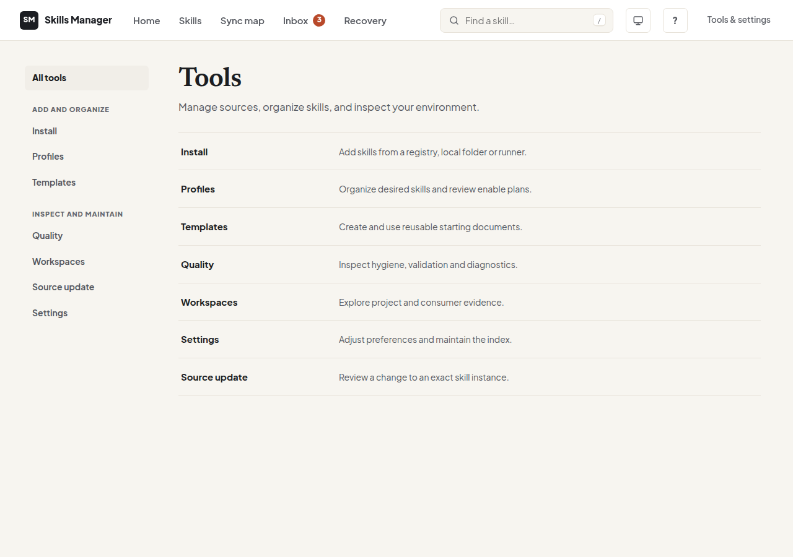

<div align="center">

# skills-manager

**One place to see, fix, sync and back up the `SKILL.md` skills of every AI coding agent on your machine.**

A local CLI and web UI for Claude Code, Codex, Cursor, OpenCode, Gemini CLI, Command Code and anything that reads `~/.agents/skills`.
No account, no telemetry, no runtime dependencies.

[](https://github.com/udayvarmora07/skills-manager/actions/workflows/ci.yml)
[](https://pypi.org/project/skill-control-plane/)
[](pyproject.toml)
[](LICENSE)
[](pyproject.toml)

[Install](#install) · [Quickstart](#quickstart) · [Web UI](#the-web-ui) · [Recipes](#recipes) · [Privacy](#what-it-will-not-do-and-what-leaves-your-machine) · [Docs](#documentation-map) · [Contributing](#contributing)



<sub>The web UI at 1280 × 900, captured with synthetic fixtures. No personal skills are shown.</sub>

</div>

> **Names at a glance.** GitHub repository: `udayvarmora07/skills-manager`. The `skill-control-plane` distribution is available on PyPI. The Python import package remains `skillsmgr`, and the command you run is `skills-mgr`.

---

## Table of contents

- [Why this exists](#why-this-exists)
- [Features](#features)
- [Install](#install)
- [Quickstart](#quickstart)
- [Core ideas in 60 seconds](#core-ideas-in-60-seconds)
- [Agent scopes](#agent-scopes)
- [The web UI](#the-web-ui)
- [Recipes](#recipes)
- [AI assist (optional, bring your own key)](#ai-assist-optional-bring-your-own-key)
- [What it will not do, and what leaves your machine](#what-it-will-not-do-and-what-leaves-your-machine)
- [How it works](#how-it-works)
- [Troubleshooting and FAQ](#troubleshooting-and-faq)
- [Documentation map](#documentation-map)
- [Contributing](#contributing)
- [Security](#security)
- [Roadmap](#roadmap)
- [License](#license)

---

## Why this exists

[Agent Skills](https://agentskills.io) (`SKILL.md` folders) are an open format that many coding agents now load. Once you use more than one agent, the skills pile up in several places:

- **Copies drift.** The same skill sits in `~/.claude/skills`, `~/.codex/skills` and `~/.agents/skills`. You fix one copy and forget the others.
- **Skills fail silently.** A byte-order mark, an unquoted `:` in the frontmatter or a listing over the agent's budget can make an agent skip or truncate a skill. Nothing tells you.
- **Mistakes are hard to undo.** A bad edit or a deleted folder has no history and no trash.

`skills-manager` takes inventory of the copies already on your machine. It shows where they differ and flags what an agent would likely drop. Every change goes through a reviewable, reversible step.

**How it relates to other tools.** [Vercel's `skills` CLI](https://github.com/vercel-labs/skills) installs and updates skills from a source into many agents. This project manages the copies you already have: it inspects them, compares them, keeps them in sync and recovers them. The two work together, and `skills-mgr install` can call the `skills` CLI for you.

## Features

| | |
|---|---|
| **See everything** | One inventory across every agent's skill folder, with duplicates, drift and broken copies marked. |
| **Lint what agents silently skip** | `validate` and `doctor --hygiene` flag malformed frontmatter, oversized bodies, dead links, vague descriptions, ignored keys and listing-budget overflow for Claude Code and Codex. |
| **Sync on purpose** | Copy a skill from one agent to others. Overwrites are explicit, and a snapshot of the old copy is kept. |
| **Undo anything** | Removal goes to a trash, edits keep snapshots, and full backups are one command away. |
| **Review before you update** | Updating from a folder or the [skills.sh](https://skills.sh) registry shows a diff, validation and advisory risk findings, then waits for your approval. |
| **Explain agent behaviour** | `doctor --explain` shows which copy a given agent would load and which copies it shadows, with the vendor doc it relied on. |
| **Budget context** | `tokens` shows how much of a model's context window your skills take. |
| **Local web UI** | A full interface on `127.0.0.1`, vendored Vue, no build step, works offline. |
| **Optional AI checks** | Bring your own key to test whether a skill gets picked, tighten descriptions and get review briefings. Off by default. |
| **Zero dependencies** | Python standard library only. |

## Install

Requires **Python ≥ 3.11** on Linux, macOS or Windows.

```bash
pipx install skill-control-plane   # recommended: isolated app environment
# or
pip install skill-control-plane
```

Check it works:

```bash
skills-mgr --version
```

<details>
<summary><b>Run from source instead</b></summary>

```bash
git clone https://github.com/udayvarmora07/skills-manager
cd skills-manager
python3 -m skillsmgr --help   # nothing to install; stdlib only
```

Anywhere this README says `skills-mgr`, you can use `python3 -m skillsmgr`.

</details>

## Quickstart

Five minutes, nothing is changed until step 3.

```bash
# 1. What agents and skill folders do you have?
skills-mgr scopes

# 2. Every skill, across every agent, in one table
skills-mgr list --scope all

# 3. Create a skill in the manager's own library
skills-mgr create deploy-staging \
  -d "Deploys the staging stack. Use when shipping a branch to staging."

# 4. Copy it to the agents you use
skills-mgr sync deploy-staging --to claude-code --to agents

# 5. Prefer clicking? Open the local web UI
skills-mgr webui
```

Then try the health checks:

```bash
skills-mgr validate --all                 # lint against the Agent Skills spec
skills-mgr doctor --hygiene --scope all   # duplicates, drift, parse risks, listing budgets
skills-mgr tokens --scope all             # context-window footprint
```

> **Want a sandbox first?** Point the tool at a throwaway directory and your real data stays untouched:
>
> ```bash
> export SKILLS_MANAGER_DATA="$(mktemp -d)"
> ```
>
> Agent scopes still read your real home folders. To isolate those too, also set `HOME` to a temporary directory.

## Core ideas in 60 seconds

1. **The filesystem is the truth.** A skill is a folder holding `SKILL.md`. The manager's library lives at `~/.local/share/skills-manager/skills/` by default. A SQLite file next to it is only a search index, and `skills-mgr db rebuild` regenerates it at any time.
2. **Scopes are places.** `global` is the manager's own library. Every other scope is an agent's own skill folder, and the tool reads and writes it directly. See [Agent scopes](#agent-scopes).
3. **Disabled means renamed.** Disabling turns `SKILL.md` into `SKILL.md.disabled` in place, so agents stop loading the skill and nothing is lost.
4. **Nothing disappears.** `remove` moves a skill to trash, and `restore` brings it back. `--purge` is the only permanent delete.
5. **Review, then apply.** Updates and registry installs create a short-lived review with a diff and findings. Nothing is written until you approve that exact review.
6. **Evidence, not verdicts.** Risk and hygiene findings are advisory. The tool never calls a skill "safe", and it never guesses an agent's load order where the vendor has not documented one.

## Agent scopes

| Scope id | Folder | Read by |
|---|---|---|
| `global` (default) | `~/.local/share/skills-manager/skills/` | the manager's own library |
| `claude-code` | `~/.claude/skills` | Claude Code |
| `codex` | `~/.codex/skills` | Codex |
| `cursor` | `~/.cursor/skills` | Cursor |
| `opencode` | `~/.config/opencode/skills` | OpenCode |
| `gemini` | `~/.gemini/skills` | Gemini CLI |
| `commandcode` | `~/.commandcode/skills` | Command Code |
| `agents` | `~/.agents/skills` | Codex, Command Code, OpenCode and other tools that read the shared folder |
| `all` | every scope above, merged | read-only combined view |

Project-local folders (for example `<project>/.claude/skills`) appear as extra scopes when present. `skills-mgr scopes` lists what exists on your machine.

`list`, `view`, `search`, `doctor` and `stats` take `--scope`. `sync` copies between scopes, and `tokens` and `install` have their own `--scope` meanings. Details: [CLI reference](docs/03-cli-surface.md).

## The web UI

```bash
skills-mgr webui                 # http://127.0.0.1:8765 and opens your browser
skills-mgr webui --no-browser    # server only
skills-mgr webui --port 9000     # another port
```

| Page | What you do there |
|---|---|
| **Home** | See what needs attention: broken copies, drifted copies, items in trash, recent activity. |
| **Skills** | Browse, filter, tag, read, edit, enable/disable and batch-act on exact copies. |
| **Sync map** | See which agents have which skill, and where the copies differ. |
| **Inbox** | Work through problems one at a time, with an explained fix for each. |
| **Recovery** | Trash, snapshots, history, backups and imports. |
| **Tools** | Install from the registry, profiles, templates, quality report, workspaces, AI assist and settings. |

Press <kbd>Ctrl</kbd>/<kbd>⌘</kbd> + <kbd>K</kbd> for the command palette and <kbd>?</kbd> for shortcuts. The classic interface is still at `/classic/`.

> ⚠️ **The web UI has no login.** It binds to `127.0.0.1`, and that binding is its only security boundary. Any program on your machine can reach it. Never forward, tunnel or publish the port. See the [threat model](skills-manager-threat-model.md).

<details>
<summary><b>Open it as a desktop window</b></summary>

The optional `desktop_launcher.py` (repository only, not in the package) opens the same UI in a chromeless Chromium app window, and falls back to your browser:

```bash
python3 desktop_launcher.py
```

</details>

<details>
<summary><b>Build on top of it (REST API)</b></summary>

The same server is a JSON REST API for local scripts and editor extensions. Call it at `127.0.0.1` (not `localhost`) from a host process, not from a web page. Contract: [docs/08-web-ui.md](docs/08-web-ui.md#local-client-integration-contract-non-browser-clients--issue-8).

</details>

## Recipes

<details open>
<summary><b>Find and fix copies that drifted apart</b></summary>

```bash
skills-mgr doctor --scope all                     # lists same-name skills whose copies differ
skills-mgr view deploy-staging --scope claude-code
skills-mgr sync deploy-staging --from claude-code --to agents --force   # old copy is snapshotted first
```

In the web UI, **Sync map** and **Inbox** do the same thing visually.

</details>

<details>
<summary><b>Find out why an agent ignores a skill</b></summary>

```bash
skills-mgr validate --all
skills-mgr doctor --hygiene --scope all
skills-mgr doctor --explain claude-code --project . --skill deploy-staging
```

The hygiene report covers frontmatter that agents' parsers silently drop, an estimate of the Claude Code and Codex skill listings against their budgets, files OpenCode would truncate, and `~/.agents/skills` entries Claude Code cannot see.

</details>

<details>
<summary><b>Turn a skill off without deleting it</b></summary>

```bash
skills-mgr disable deploy-staging     # SKILL.md -> SKILL.md.disabled
skills-mgr enable  deploy-staging
```

On the command line `disable`/`enable` act on the manager library; turn a copy in an agent folder on or off from the web UI's Skills page.

</details>

<details>
<summary><b>Undo a removal or a bad edit</b></summary>

```bash
skills-mgr remove deploy-staging      # goes to trash
skills-mgr trash list
skills-mgr restore deploy-staging

skills-mgr history deploy-staging     # lists retained snapshot ids
skills-mgr restore deploy-staging --snapshot <ID>
```

</details>

<details>
<summary><b>Back up and move to another machine</b></summary>

```bash
skills-mgr export --full --dest skills-backup.tar.gz   # skills + trash + templates
skills-mgr import skills-backup.tar.gz --full          # on the other machine
```

Archives are checked before anything is written: size limits, path traversal, links and a versioned manifest.

</details>

<details>
<summary><b>Update a skill safely from a folder</b></summary>

```bash
skills-mgr update preview deploy-staging --from ./deploy-staging-v2   # diff + validation + risk, writes nothing
skills-mgr update apply   deploy-staging <REVIEW_ID> --yes            # snapshot, then atomic swap
skills-mgr update snapshots deploy-staging                            # rollback points
```

</details>

<details>
<summary><b>Install from the skills.sh registry with a review step</b></summary>

```bash
skills-mgr install --search "react native"
skills-mgr install --fetch vercel-labs/skills/find-skills --json        # download + review, nothing installed
skills-mgr install --fetch --review <REVIEW_ID> --trust-confirmed       # commit exactly what you reviewed
```

Or hand off to the `skills` CLI, previewing first:

```bash
skills-mgr install vercel-labs/agent-skills --dry-run
```

Background and limits: [ADR-005](docs/ADR-005-registry-network-and-provenance.md).

</details>

<details>
<summary><b>Lint skills in CI</b></summary>

A copy-paste pull-request check built on `skills-mgr validate --path`: [docs/36-skill-ci-recipe-2026-11-08.md](docs/36-skill-ci-recipe-2026-11-08.md).

</details>

<details>
<summary><b>Measure whether a skill actually helps (evals)</b></summary>

Put an [`evals/evals.json`](https://agentskills.io/skill-creation/evaluating-skills) inside the skill, then:

```bash
skills-mgr validate deploy-staging --evals
skills-mgr validate deploy-staging --evals-run runs.json   # grades with/without-skill outputs
```

Scores are written as files under the data directory. They are advisory and never block an install or edit. See [ADR-003](docs/ADR-003-registry-bridge-and-eval-harness.md).

</details>

## AI assist (optional, bring your own key)

AI features are **off until you choose a provider** in the web UI (**Tools → AI assist → Settings**). Supported providers: Anthropic, OpenAI-compatible endpoints (OpenAI, OpenRouter, Gemini's compatibility endpoint) and local models through Ollama or LM Studio.

- **Trigger test:** does the agent pick the right skill for a given prompt?
- **Improve a description:** proposals verified on held-out prompts, applied only through a normal edit.
- **Overlap check, listing-budget fit, porting notes, risk-finding explainer, ask your library, draft a skill, conciseness advice, profile suggestions.**

Guard rails: environment-variable keys take precedence, and a stored key is never returned by the API. Every call runs against per-run and per-day token caps that you set. Every page offers an estimate mode that sends nothing. Model output is never written to a skill without your explicit, snapshot-backed approval.

From the CLI or CI (estimate by default; `--run` sends):

```bash
skills-mgr ai trigger-test --scope claude-code --saved --json
```

Details: [AI CLI/CI contract](docs/42-ai-cli-ci-2026-11-09.md) and [AI features research](docs/39-ai-features-research-and-catalogue-2026-11-09.md).

## What it will not do, and what leaves your machine

Checked against the source. Only `skillsmgr/registry.py` and the optional AI client open network connections themselves. Every other connection below comes from a program you chose to run.

It will **not**:

- send telemetry, analytics, crash reports or update checks;
- run in the background or install a daemon;
- write an agent's native settings files (Claude Code `skillOverrides`, OpenCode `permission.skill`, Codex `config.toml` and similar are read for display only);
- pick a winner where an agent's loading order is undocumented;
- delete a skill outright unless you ask it to purge (removal goes to trash);
- listen on anything but loopback.

Network traffic happens **only** in these cases:

| When | Where it goes | What is sent |
|---|---|---|
| You browse, search or fetch from the registry | `https://skills.sh` only; other hosts and redirects are refused | The query or skill id, plus `SKILLS_MANAGER_REGISTRY_TOKEN` / `VERCEL_OIDC_TOKEN` if you set one |
| You run a package install (`install SOURCE` without `--dry-run`/`--preview`) | Whatever `npx`/`pnpm`/`yarn`/`bunx skills add` contacts | Decided by that tool, not by this one |
| You turn on AI assist and run a check | The provider and endpoint you configured | The prompts, skill names and descriptions (and, for some checks, skill bodies) that the check shows you in estimate mode |
| You opt into the SkillSpector scan (`--external-scan`) | `api.osv.dev`, from SkillSpector | Declared dependency names |
| You opt into its LLM mode (`--external-scan-llm`) | The LLM provider you configured | Skill file contents, using your own key from the environment |
| `tiktoken` is installed (optional) | tiktoken's download host, once, then cached | A request for the `cl100k_base` encoding file |

`webui` also opens your default browser on the local URL. Pass `--no-browser` to skip that.

## How it works

```text
 skills-mgr (CLI)        web UI (Vue, vendored)
        │                       │  JSON over 127.0.0.1
        └───────────┬───────────┘
                    ▼
         Store  +  scopes layer           ← one code path for both front-ends
           │              │
           ▼              ▼
  manager library    agent folders        ← the filesystem is the source of truth
  (SKILL.md files)   (~/.claude/skills, ~/.agents/skills, …)
           │
           ▼
   SQLite index (rebuildable cache, never authoritative)
```

- **Data directory:** `$SKILLS_MANAGER_DATA` → `$XDG_DATA_HOME` → `~/.local/share`, then `/skills-manager`. It holds `skills/`, `trash/`, `backups/`, `templates/`, `snapshots/` and the index. Unsafe roots (shared or world-writable) are refused. `--data-dir PATH` overrides the location for one command.
- **Locking:** a CLI process and a web UI process on the same data directory exclude each other through advisory file locks.
- **Safety:** every skill name is validated before it becomes a path, and every path is checked to stay inside its root. Uploads and archives are size-bounded. Skill text is escaped everywhere it is displayed.

Deeper reading: [architecture](docs/01-architecture.md) · [modules](docs/02-modules.md) · [Store API and schema](docs/04-store-api.md).

## Troubleshooting and FAQ

<details>
<summary><b>"unsafe data directory: … is writable by another user"</b></summary>

The data root must be private to you:

```bash
chmod 700 ~/.local/share/skills-manager
```

</details>

<details>
<summary><b><code>doctor</code> reports index drift</b></summary>

The SQLite index is a cache. Rebuild it from the files:

```bash
skills-mgr db resync     # or: skills-mgr db rebuild
```

</details>

<details>
<summary><b>The web UI answers 403</b></summary>

Use `http://127.0.0.1:<port>`, not `localhost`. The server only accepts its own loopback host and same-origin requests.

</details>

<details>
<summary><b>Port 8765 is already in use</b></summary>

```bash
skills-mgr webui --port 9000
```

</details>

<details>
<summary><b>Does disabling a skill here change Claude Code's <code>skillOverrides</code>?</b></summary>

No. Disabling renames the file. Native settings are shown read-only in the skill detail, so you can see both.

</details>

<details>
<summary><b>Is my data uploaded anywhere?</b></summary>

No, unless you use one of the opt-in features listed in [what leaves your machine](#what-it-will-not-do-and-what-leaves-your-machine).

</details>

<details>
<summary><b>Exit codes and machine-readable output</b></summary>

`0` ok · `1` error · `2` usage · `130` interrupted. Most commands accept `--json`. See the full [CLI reference](docs/03-cli-surface.md).

</details>

## Documentation map

| If you want to… | Read |
|---|---|
| Learn every command and flag | [docs/03-cli-surface.md](docs/03-cli-surface.md) |
| Understand the design | [docs/01-architecture.md](docs/01-architecture.md) |
| Use the REST API or web UI internals | [docs/08-web-ui.md](docs/08-web-ui.md) |
| Migrate hand-managed skill folders safely | [docs/17-adoption-and-distribution.md](docs/17-adoption-and-distribution.md) |
| See why decisions were made | the `docs/ADR-*.md` files, starting at [docs/README.md](docs/README.md) |
| Know what changed in each release | [CHANGELOG.md](CHANGELOG.md) |
| Work on the code with an AI agent | [AGENTS.md](AGENTS.md) and [docs/SESSION-CONTEXT.md](docs/SESSION-CONTEXT.md) |

An agent-facing management skill ships inside the package at `skillsmgr/examples/skills-manager-management/`. Copy it into your agent's skills folder to let the agent drive this tool with preview-first, approval-gated steps.

## Contributing

Contributions are welcome. Bug reports, new agent scopes, validation rules, UI polish and tests are especially useful. Start with [CONTRIBUTING.md](CONTRIBUTING.md), which covers setup and every check CI runs.

```bash
git clone https://github.com/udayvarmora07/skills-manager && cd skills-manager
python3 -m unittest discover -s tests   # stdlib only, no network
python3 smoke_store.py && python3 smoke_web.py
python3 check_docs.py && python3 check_complexity.py
```

The project holds a few deliberate constraints, and changes to them need maintainer approval:

1. The filesystem stays the source of truth.
2. The SQLite schema stays unchanged.
3. The CLI stays stdlib-only.
4. The web UI keeps a stdlib backend, no build step, no new runtime dependencies and a loopback bind.
5. No new CLI commands or Store methods without approval. Propose them in an [issue](https://github.com/udayvarmora07/skills-manager/issues) or a draft PR first.

## Security

Please report vulnerabilities privately, as described in [SECURITY.md](SECURITY.md). Design notes: [threat model](skills-manager-threat-model.md) · [security review](security_best_practices_report.md) · [static analysis policy](docs/STATIC-ANALYSIS.md). Release artifacts are built with a hash-pinned toolchain and carry build provenance attestations.

## Roadmap

See [ROADMAP.md](ROADMAP.md) for what is shipped, what is next and what is still a proposal.

## License

[MIT](LICENSE). Built on the open [Agent Skills](https://agentskills.io) format. Thanks to everyone who files issues and shares skills.
